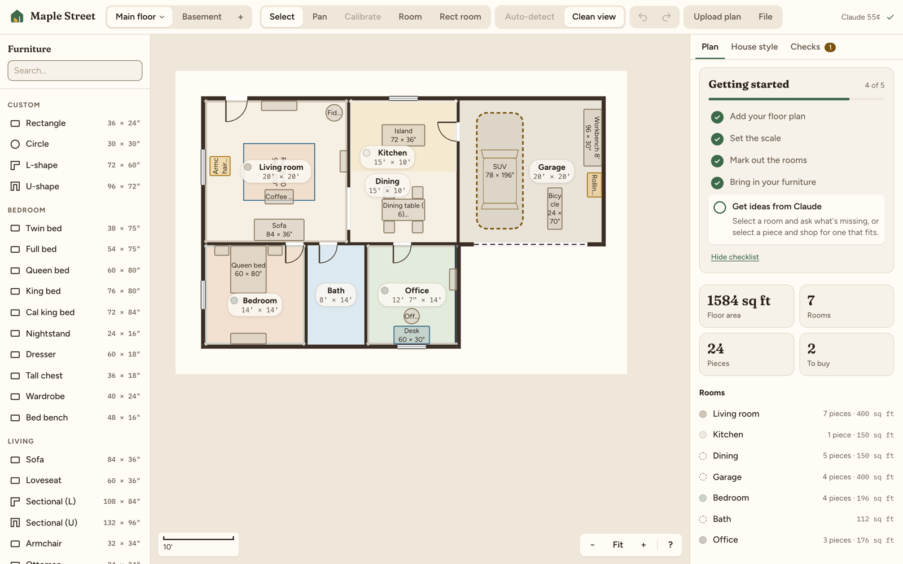
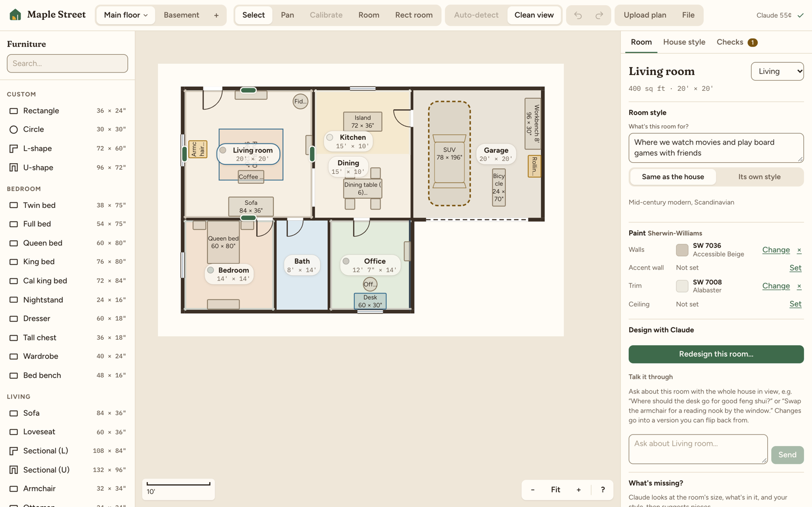
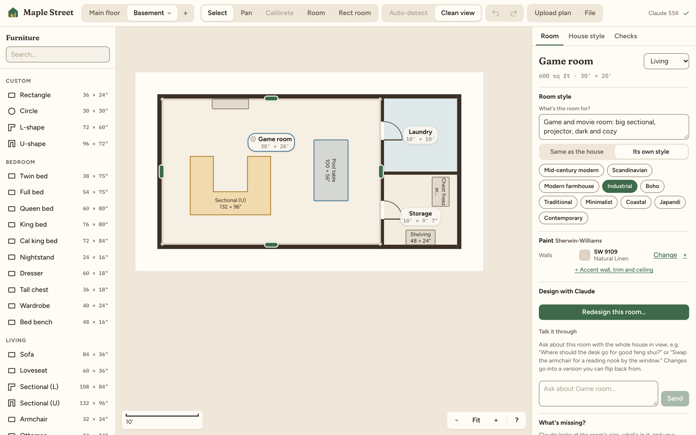
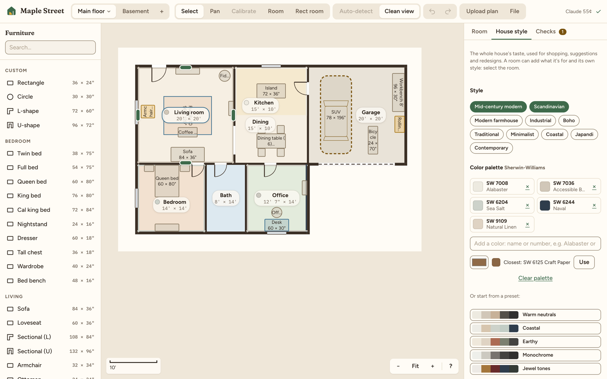
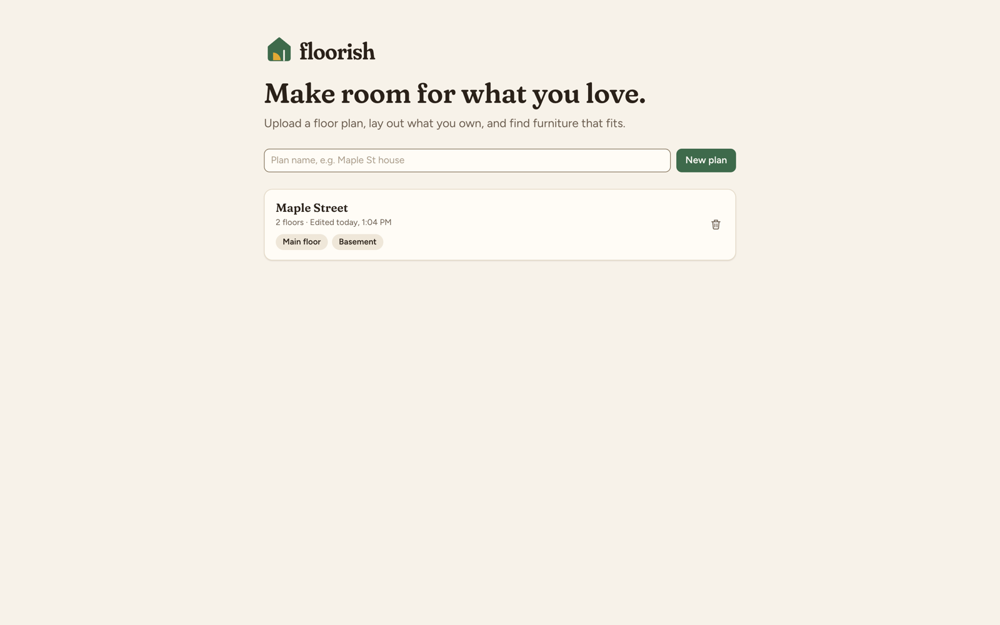

# Floorish

[](https://github.com/pmschartz/floorish/actions/workflows/test.yml)

**Make room for what you love.** Upload a floor plan, lay out the furniture you already own at real scale, and let Claude suggest and shop for pieces that actually fit.



> Floorish is built by describing what I want to [Claude Code](https://claude.com/claude-code), checking it in the running app, and iterating. I direct the product; Claude writes the code. More in [How it's built](#how-its-built).

---

## Why I built it

I was planning a basement finish and furnishing a house at the same time, and kept hitting the same wall: I had a floor plan (a PDF from the builder, with dimensions printed on it), a list of furniture I already owned, and a lot of browser tabs of things I might buy. None of those knew about each other. Would the sectional fit with room to walk past? Is there 30" to open the car doors next to a workbench? Does this rug work with the paint color I picked?

Room planners exist, but they make you redraw your house from scratch, their furniture rarely matches what you own, and their shopping is a catalog, not "find me something that fits this exact spot in my style." I wanted one place where the plan, my stuff, my taste and the shopping all talk to each other.

## Product brief

### Problem

Furnishing a home means making many small spatial decisions with incomplete information. Floor plans live in PDFs, measurements live in your head, and product listings don't know the size of your wall. Mistakes are expensive: a sofa that doesn't fit, a door that hits the bed, a rug in the wrong color.

### Who it's for

People furnishing or rearranging a home they already have a floor plan for: new homeowners, renters before a move, anyone finishing a basement or redoing a room. They aren't designers and don't want to learn CAD.

### Goals

1. **Get from a floor plan to an accurate, editable layout in minutes**, without redrawing the house.
2. **Put what you own and what you want on the same plan, at real scale**, and catch problems (overlaps, blocked doors, walkways too tight) before you buy.
3. **Make suggestions and shopping specific to the space**: the room's size, what's already there, the house's style and palette, and what the room is for.
4. **Keep it cheap to run.** AI calls cost real money, so never pay twice for the same answer.

### Non-goals

- Accounts, sharing or a hosted service. It's a local app for one household.
- 3D rendering or photo-realistic visualization.
- Construction drawings. Walls are tidy and consistent, not to code.
- Checkout. Shopping links out to retailers.

### Requirements

| Priority | Requirement | How Floorish meets it |
| --- | --- | --- |
| P0 | Import a floor plan and set its scale | Upload PNG, JPG, SVG or PDF; click both ends of a known wall to calibrate. Or start on a blank grid. |
| P0 | Turn the plan into rooms, doors and windows | **Auto-detect** has Claude read room names, doors (with hinge and swing), windows and printed dimensions; the app snaps them to the walls it measures in the image and standardizes wall thickness. You review before anything is added. |
| P0 | Place furniture at real size | A library of standard pieces (bedroom, living, dining, office, gym, plants, garage, rugs, doors and windows) plus custom shapes. Every piece is marked as *have it*, *planned* or *to buy*. |
| P0 | Catch layout problems | Live checks for overlaps, pieces through walls, door swings and clearances (bed sides, drawers, chair pull-back, car doors), measured to walls and furniture, not to open sides between rooms. |
| P1 | Suggest what a room is missing | **What's missing** sends the room's shape, contents and style to Claude and adds a suggestion to the plan in one click, in an open spot. |
| P1 | Shop for a piece that fits | **Shop for this** has Claude search the web for real products that fit the shape, your style and palette, and labels each one *Fits*, *Tight* or *Too big* from its listed dimensions. |
| P1 | Redesign a room | **Redesign** proposes alternative layouts you can flip between as versions; **room chat** talks a room through with the whole house in view. |
| P1 | Style at house and room level | A shared **House style** (styles, Sherwin-Williams palette, things to avoid, budget), and per-room style: "what's this room for?" plus the room's own styles. |
| P1 | Multi-floor homes | A house has floors (tabs in the toolbar) that share one style; Claude sees the rooms on every floor. |
| P2 | Paint planning | Each room's walls, accent wall, trim and ceiling as Sherwin-Williams colors. |
| P2 | Export | The plan as PNG, and a shopping list with paint as Markdown or CSV. |

### Success measures

- **Time to a usable layout**: an uploaded plan becomes rooms, doors and windows in one Auto-detect pass plus a quick review.
- **Problems caught before buying**: layout checks flag issues as you move things.
- **Cost per session**: the toolbar shows what Claude cost today; repeated requests come from a saved answer for free.

### Key decisions

- **Claude reads, the app measures.** Claude is good at reading a floor plan's labels and symbols; pixel geometry is better done in code. Auto-detect takes Claude's reading and snaps it to walls found in the image, so every upload ends up with clean, consistent walls.
- **Rooms make space for each other.** Drawing a closet in a bedroom cuts it out of the bedroom with a wall; deleting it gives the space back. Plans stay accurate as you edit, not just when imported.
- **Spend like it's your money.** System prompts and chat history are cached, results are saved on the plan (shop results, suggestions, chats), identical requests reuse a 30-day saved answer, the lighter model handles What's missing, and every call is logged so the toolbar can show the day's cost.
- **Local first.** Plans are JSON files on disk; the API key never reaches the browser.

## Screenshots

**A room, selected.** What it's for, its paint, and Claude's design tools. Rooms are tinted by type; walls are drawn to a standard thickness.



**Its own style.** The basement game room is described in plain words and picks Industrial over the house's mid-century style, so suggestions and shopping for it differ from the rest of the house.



**House style, shared across floors.** Styles, a Sherwin-Williams palette, and presets.



**Houses with floors.**



*Screenshots show a made-up demo house.*

## How it's built

Floorish is vibe-coded. I work in [Claude Code](https://claude.com/claude-code): I describe what I want in plain language, try it in the running app, and point at what's wrong ("the walls between these rooms are jagged", "this toolbar overflows", "a closet should split the bedroom, not sit on top of it"). Claude plans the change, writes the code and tests, checks its work in a browser, and commits.

- **The loop is product work.** Decide what it should do, look at the result, give specific feedback. Most changes start from something I saw in the app, not from a spec.
- **Real data drives the fixes.** Wall detection improved by testing against an actual builder's floor plan: walls drawn as outlines, jagged runs that should be straight, missing walls between rooms, inconsistent thicknesses. Each problem became a rule in code (merge outlined walls, align near-collinear edges, standardize thickness) and a test, so every later upload benefits.
- **Cost is a requirement.** When I noticed answers weren't being saved, the fix went further: caching, saved answers, a lighter model for lighter tasks, and a spend meter, so running it stays cheap.
- **Tests and CI keep it honest.** Geometry, layout checks, wall detection and storage are unit-tested, and tests run on every push.
- **Design comes from a design system.** Claude built the *Floorish* brand (colors, type, logo, icons) as a design system, then restyled the app with it.

### Stack

- **Client**: React, TypeScript, Vite, Konva (canvas), Zustand with undo/redo.
- **Server**: Express, saving plans as JSON on disk; Zod schemas shared with the client.
- **AI**: the Anthropic SDK with `claude-opus-5-5` (detect, redesign, chat, shopping with web search) and `claude-sonnet-5-5` (What's missing).

## Run it

```bash
npm install
cp .env.example .env   # add ANTHROPIC_API_KEY, or skip if you've run `ant auth login`
npm run dev            # http://localhost:5173
```

Plans are saved to `data/` (ignored by git). Try it with `samples/sample-floorplan.svg`: calibrate on the red 32'-0" line along the top. Press **?** in the editor for keyboard shortcuts.

## Claude and cost

Auto-detect, redesigns, room chat and shopping use `claude-opus-5-5`; What's missing uses `claude-sonnet-5-5`. A shopping search uses live web search (up to 5 searches) and typically costs a few cents to about $0.30.

To keep costs down, system prompts and chat history are cached, and results are saved: shop results on the piece, suggestions and chat on the room, and identical Auto-detect and Redesign requests are answered from a 30-day cache unless you ask again. The toolbar shows what Claude has cost today (from `data/usage.jsonl`, at list price).

Requests use server-side fallback (`fallbacks: "default"`), so a request the model declines is retried on a fallback model; remove `FALLBACK` in `server/claude/client.ts` to turn that off.

## Develop

```bash
npm test          # unit tests
npm run typecheck
```

- `src/` React + Konva client; `server/` Express API and Claude calls; `shared/` Zod schemas used by both.
- All lengths are stored in inches; `pxPerInch` maps them onto the floor plan image.
- The look comes from the Floorish design system: tokens and fonts in `src/floorish.css`, canvas colors in `src/canvas/theme.ts`.
